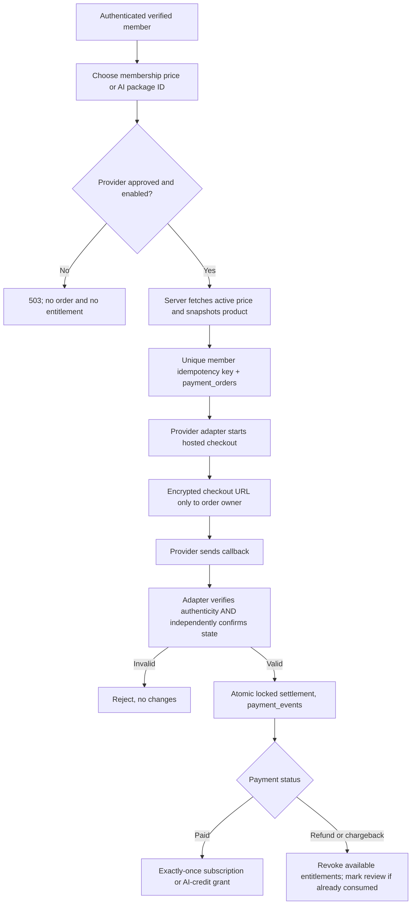

# PM Circle — gateway-neutral payment backend (2026-11-19)

## Implementation status

**Implemented in source only.** Real merchant charging, hosted checkout, provider signatures and live reconciliation are **not implemented or activated**. `PM_PAYMENTS_ENABLED=false` by default, and the only bound adapter is `UnconfiguredGateway`, which rejects every attempt. Setting an environment variable to `bkash` or `nagad` **does not enable charging**. No changes were made to pricing pages, shared UI components, coupon display, existing signup flow or public simulator mockups.

## Existing code inspected

- `plans`, `plan_prices`, `subscriptions`, `CurrentMemberPlan` provide membership catalog and entitlement checks.
- `ai_credit_packages`, legacy `ai_credit_orders`/`ai_gateway_events`, `AiCreditService` provide credit accounting.
- `SetTemporaryMembership` is a **separate, explicitly opted-in** non-billed access path, not proof of payment.
- `ProfileCompletionRewardService` is explicitly limited to **simulator** purchases; do not apply its coupon to Plus/Pro membership or AI packages.
- No merchant integration has been approved; the app already rejects real AI checkout by default.

## Central design



`payment_orders` contains the financial source of truth and an immutable product/price snapshot; `payment_events` records independently verified event IDs, hashes and outcomes. There is no endpoint that marks an order paid based on a browser success return. Old `ai_credit_orders` remain readable for existing order-status links, but all **new** AI purchases use `payment_orders` and its event settlement pipeline. The old AI gateway interface is retained for backward compatibility but is not used for new purchases.

### Backend routes (all JSON)

| Method/path | Access | Purpose |
| --- | --- | --- |
| `POST /billing/membership-checkout` | Authenticated, verified, onboarded, rate-limited | `{ "plan_price_id": 1, "client_request_key": "UUID" }` |
| `GET /billing/orders/{uuid}` | Order owner only | Order state, price/currency, optional active encrypted-at-rest hosted URL |
| `POST /billing/ai-checkout` | Same member protections | Existing `{ "package_id": 1, "client_request_key": "UUID" }` |
| `GET /billing/ai-orders/{uuid}` | Order owner only | New central AI orders and legacy order reads |
| `POST /webhooks/payments/{bkash\|nagad}` | Provider only, verified by adapter | Server-side receipt confirmation and settlement |

The client is **not** allowed to supply amount, currency, gateway choice, paid flag, discount or subscription dates. Server snapshot amounts use integer minor units (`39900` = BDT 399.00). A duplicate client UUID for a different item returns `409`. Unique database constraints prevent repeated processing of provider transaction IDs and event IDs.

### Error handling and protections

- No approved adapter / disabled checkout: `503 PAYMENT_GATEWAY_NOT_CONFIGURED`, no financial row.
- Reused idempotency key with different item: `409 IDEMPOTENCY_KEY_REUSED`.
- No active price/package, bad currency or invalid amount: rejects before remote initiation.
- Callback provider mismatch, unverified transaction, wrong amount, wrong currency, reused transaction ID: rejects before granting.
- Provider request timeout or ambiguous failure: `initiation_unknown`, **never retry remotely by guessing**; reconcile with provider using the order UUID.
- External hosted URL must be HTTPS on a preapproved exact domain, with no embedded HTTP basic-auth credentials; URL is encrypted at rest, not logged.
- A confirmed full refund/chargeback revokes access and unspent purchased/allowance credits. Consumed or reserved credits are tracked as `reversal_review`, never a negative wallet; finance must investigate. If an AI package charge clears only after its member loses paid subscription entitlement, the verified charge is recorded as `fulfillment_review` **without delivering credits**, pending an independently verified provider refund or manual reconciliation.
- Payment callback CSRF exemption existed already and remains limited to `webhooks/payments/*`; provider authenticity is checked independently, and callbacks are throttled.
- A paid subscription renews from the later of now or the existing active entitlement end; new future-dated terms do not grant access prematurely.
- Before production enablement, switch off `PMC_SELF_SERVICE_COMPLIMENTARY_ACCESS_ENABLED` unless intentionally granting free subscriptions alongside sales.

### Provider integration checklist (do not enable until all pass)

1. Obtain approved merchant credentials and the provider's **current** sandbox/production specification. Keep secrets in server environment or secret manager; not in git, JS or database logs.
2. Implement a **single** adapter for the selected provider implementing `Contracts\PaymentGateway` (`provider`, `start`, `verify`). Register it under `payments.gateway.bkash` or `payments.gateway.nagad` in `AppServiceProvider` after code review; leave the other provider fail-closed until independently approved. Keep the old provider adapter active for verified refunds even after switching the checkout provider. `start` must pass `payment_orders.uuid` as the provider idempotency reference and the server-generated amount/currency. Only `CheckoutSession` (HTTPS checkout URL and safe reference) may be returned.
3. `verify` must authenticate the callback using the provider's required method **and independently fetch verified payment status from the provider's server** (merchant account, transaction ID, order reference, amount, currency, capture state). For providers with asynchronous status, return an error/retry until settlement is independently known. Construct `DTO\VerifiedPayment` only from verified provider information, never client/request JSON alone. Use a deterministic unique event ID for retries.
4. Configure provider-specific API timeouts, TLS certificate validation, credentials rotation, bounded retries with provider idempotency and rate limits. Verify signed callbacks and provider transaction references in sandbox. Do not turn the site redirect into a source of truth.
5. Test lost responses, duplicate callbacks, reordered events, amount mismatches, concurrent renewals, reversals after consumed credits, unknown orders, currency errors, provider outage, duplicate provider references and payment stuck in `initiation_unknown`. Set up a restricted **read-only reconciliation process** and a finance manual-review workflow before go-live. Reconcile payment orders against merchant statements daily.
6. Approval and rollout: keep `PM_PAYMENTS_ENABLED=false` until the gateway adapter and operations checks pass. Only then set env variables and deploy; test with the provider's authorized sandbox first. **No production transactions are possible using the supplied implementation alone.**

```dotenv
PM_PAYMENTS_ENABLED=false
PM_PAYMENT_PROVIDER=
PM_PAYMENT_REDIRECT_HOSTS=
PM_PAYMENT_ORDER_TTL_MINUTES=30
PM_AI_PURCHASES_ENABLED=false
```

`PM_PAYMENT_PROVIDER` eventually becomes `bkash` **or** `nagad`; `PM_PAYMENT_REDIRECT_HOSTS` is a comma-separated list of exact approved provider checkout hostnames, without protocol. Merely changing these values is intentionally insufficient to enable payments.

### Migrations and deployment

The new migration is strictly additive: `2026_11_19_000001_create_central_payment_tables.php`. It does not rewrite existing plans, coupons, subscriptions, users, AI grants or legacy AI orders. Do not drop or reinitialize production databases.

After a verified PostgreSQL backup and normal source deployment, run:

```bash
cd /var/www/pm-circle
php8.4 artisan migrate --force
php8.4 artisan optimize:clear
php8.4 artisan route:list --path=billing
php8.4 artisan route:list --path=webhooks/payments
php8.4 artisan test --filter=CentralPaymentTest
```

The archive does not include Composer `vendor/`, so dependencies must be installed according to the existing app's deployment process. There is no React/UI change, therefore **no new Vite build is required for this backend-only patch**, provided the existing public build matches the deployed frontend. If production queues run long-lived Laravel workers, restart them through the existing controlled Supervisor deployment procedure after verifying the code and migration.

### Test coverage and limitation

`tests/Feature/Billing/CentralPaymentTest.php` tests the gateway-disabled fail-closed rule, idempotency and owner scoping, amount protection, verified settlement, duplicate callbacks, reused merchant transactions, membership reversal and AI-credit reversal. These are **test cases supplied, not claims of execution**. Run the full PHP test suite with real Composer dependencies and the approved production-equivalent PostgreSQL setup before enabling any provider. The supplied archive has no Composer vendor directory and the editing environment does not contain a PDO SQLite/PostgreSQL driver, so full PHPUnit integration tests could not be run here.
